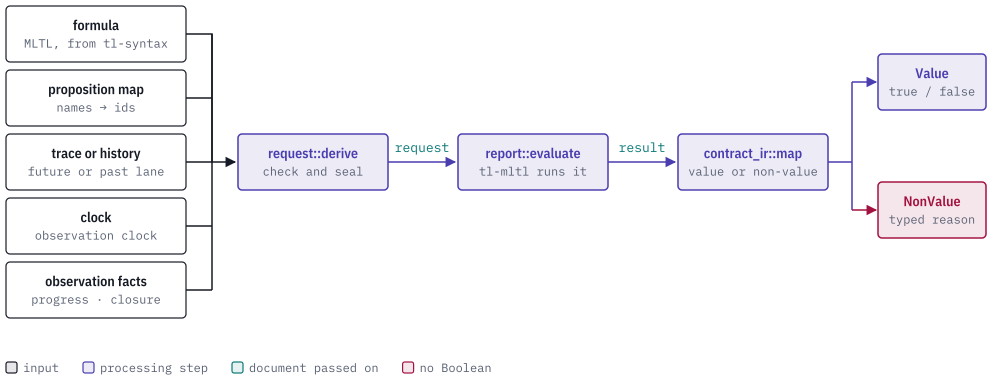
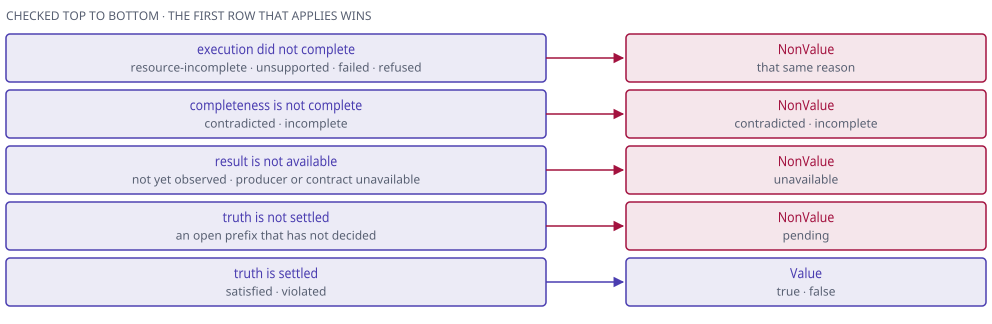
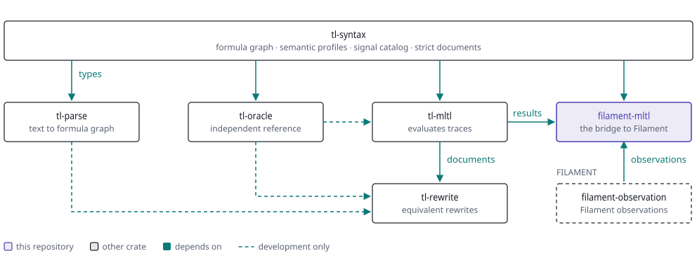

# filament-mltl

[](https://discord.gg/k8DVhuYBR2)
[](https://github.com/agent-ix/filament-spec-language)
[](#license)
[](Cargo.toml)

filament-mltl evaluates a Mission-time Linear Temporal Logic (MLTL) formula on a
recorded trace or history and gives the Filament assurance record either a Boolean
value or a named reason there is none, such as pending, unavailable or incomplete.

It takes a formula, a proposition map, a trace or history, a clock and the
progress, closure, completeness and availability facts that
[filament-observation](https://github.com/agent-ix/filament-observation) reports, and
writes them as one canonical request. Each step writes a document with its own
identity. Reading a request or mapping back re-derives it from the inputs; reading a
result back binds it to its request without re-running the evaluator, so a result
cannot be paired with the wrong request.

<picture>
  <source media="(prefers-color-scheme: dark)" srcset="docs/images/hero-dark.svg">
  
</picture>

## Getting started

filament-mltl is not on crates.io. Depend on it through git:

```toml
[dependencies]
filament-mltl = { git = "https://github.com/agent-ix/filament-mltl" }
```

Add `rev = "<commit>"` to pin a commit. It needs the Rust version in `rust-version` in `Cargo.toml`, or newer.

The build also fetches filament-observation from GitHub, so it needs read access to that repository.

To build from a clone:

```sh
git clone https://github.com/agent-ix/filament-mltl.git
cd filament-mltl
cargo build --release
```

## Usage

One request gives one result at one evaluation point, the `anchor`. The excerpt
below starts from `future_request`, a request that `request::derive` wrote and `request::read`
checked. It evaluates the request, reads the result back and maps it.

```rust
let result_document = report::evaluate(
    &future_request,
    report::ResultRelationInput::Original,
    OwnerLimits::default(),
)
.unwrap();
let result = report::read(
    result_document.bytes(),
    &future_request,
    report::ResultRelationInput::Original,
    OwnerLimits::default(),
)
.unwrap();
assert_eq!(result.truth(), report::TemporalTruth::Satisfied);

let selection = MappingSelection::for_result(&result);
let mapped_document = contract_ir::map(&result, &selection, OwnerLimits::default()).unwrap();
let mapped = contract_ir::read(
    mapped_document.bytes(),
    &result,
    &selection,
    OwnerLimits::default(),
)
.unwrap();
assert_eq!(mapped.outcome(), MappedOutcome::Value { value: true });
```

Every document carries an identity computed from its own canonical bytes. Every
`read` checks the document against its inputs and refuses on any mismatch (`report::read`
binds the recorded result to its request and never re-runs the evaluator), so a
result cannot be read against a different request and a mapping cannot be read
against a result it was not selected for. More examples are in
[docs/examples.md](docs/examples.md).

## Reference

| Module | Contract label | What it does |
| --- | --- | --- |
| `request` | `filament-mltl.temporal-assessment-request/v1` | Admits the inputs and writes one canonical request. `derive` writes it and `read` checks bytes against independently supplied inputs. |
| `report` | `filament-mltl.temporal-assessment-result/v1` | Evaluates a request with the tl-mltl future or past evaluator and records execution, truth, settlement, decision support, resource usage and the relation to an earlier result. |
| `contract_ir` | `filament-mltl.contract-ir-result-map/v1` | Maps a result to `Value { value }` or `NonValue { reason }` and embeds the whole source result. |
| `dispatch` | the request label | Reports which Filament observation contracts the crate consumes. |
| `census` | none | A closed registry of the native/temporal correspondence classes, each applicable, excluded with a reason, or blocked on a named dependency. |

| Result field | Values |
| --- | --- |
| `execution` | `completed`, `resource-incomplete`, `unsupported`, `failed`, `refused` |
| `truth` | `satisfied`, `violated`, `pending`, `unavailable` |
| `settlement` | `closed-scope`, `decisive-witness`, `decisive-counterexample`, `unsettled`, `unavailable` |
| `relation` | `original`, `superseding`, `invalidating` |

The non-value reasons are `pending`, `unavailable`, `incomplete`, `unsupported`,
`failed`, `refused`, `contradicted` and `resource-incomplete`. `contract_ir::map`
checks the result in a fixed order and the first row that applies decides the
outcome. Only a completed, complete, available and settled result becomes a Boolean.

<picture>
  <source media="(prefers-color-scheme: dark)" srcset="docs/images/outcomes-dark.svg">
  
</picture>

The JSON Schemas for the three contracts are in [`schemas/`](schemas/). See
[docs/api-reference.md](docs/api-reference.md) for the public items.

## The TL stack

filament-mltl is the one crate that connects the family to Filament.

<picture>
  <source media="(prefers-color-scheme: dark)" srcset="docs/images/tl-stack-dark.svg">
  
</picture>

## Filament ecosystem

filament-mltl depends on [tl-mltl](https://github.com/agent-ix/tl-mltl) and
[tl-syntax](https://github.com/agent-ix/tl-syntax) for the formula, trace and
evaluator, and on [filament-observation](https://github.com/agent-ix/filament-observation)
for the progress, closure, completeness, availability and clock assertions. Its
mapped outcomes are shaped to join the native/temporal correspondence contract in
[filament-contract-ir](https://github.com/agent-ix/filament-contract-ir).

<picture>
  <source media="(prefers-color-scheme: dark)" srcset="docs/images/ecosystem-dark.svg">
  
</picture>

## Building and testing

```sh
make test   # cargo test
make ci     # format, clippy, tests, cargo deny, rustdoc
```

The Rust toolchain is pinned in [`rust-toolchain.toml`](rust-toolchain.toml).
Run `make ci` before opening a pull request. The build fetches filament-observation, tl-mltl and tl-syntax from
GitHub, so it needs read access to those repositories. The requirements and
architecture decisions are in [`spec/`](spec/).

## Contributing

Read [CONTRIBUTING.md](CONTRIBUTING.md) and [CLA.md](CLA.md).

## License

Licensed under [AGPL-3.0-or-later](LICENSE). filament-mltl incorporates
filament-observation, which is also AGPL-3.0-or-later.
